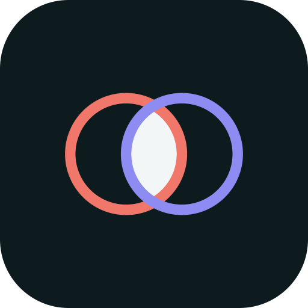

<p align="center">
  
</p>

<h1 align="center">Kythene</h1>

<p align="center">
  Work on each other's output - your team and their AI.
</p>

<p align="center">
  <a href="https://kythene.com">kythene.com</a> &middot;
  <a href="https://www.kythene.com/docs">Docs</a> &middot;
  <a href="https://www.kythene.com/pricing">Pricing</a> &middot;
  <a href="https://www.kythene.com/self-hosting">Self-hosting</a>
</p>

---

Kythene is where a team and their AI agents work on each other's output: publish any result, review it down to the individual block, approve it, and have the feedback land back in the AI that made it, with the reviewed work accreting into a memory the whole team recalls. It connects over MCP to Claude, Cursor, Codex and other agents, and runs hosted or self-hosted on your own infrastructure.

## Connect in one paste

Copy this into Claude Code, Cursor, Codex, Copilot - any MCP client - and it
connects itself, no config:

> You are my AI assistant. Connect yourself to Kythene by fetching
> https://kythene.com/setup-prompt.md and doing exactly what it says.

## MCP endpoint

```
https://kythene.com/mcp/kythene
```

A standard **remote, streamable-HTTP** MCP server. Auth is **OAuth 2.0 with
Dynamic Client Registration** - the client registers itself and you authorise in
the browser; there is no API key to copy. Self-host installs serve the same
endpoint at their own domain.

## Tools

Kythene exposes **64** MCP tools. This list is generated from the
running server, so it is exactly what the current release ships:

- **`add_contact`** - Add a contact: `display_name`, and `identities` - each a `channel` (email, slack, phone, site:<app>) and an `id` on it.
- **`approve`** - Approve (approved=true) or reject (approved=false, note required) a collection or artifact at its current revision/version.
- **`assign_action`** - Say who owes an action.
- **`brief`** - Open a session with ONE call instead of four.
- **`catch_up`** - See what changed since your agent last looked, AND what has been put on your plate - call this at the START of a session to open caught up.
- **`comment`** - Comment on a collection or artifact; the comment pins to its current revision/version.
- **`create_collection`** - Create a collection from one or more artifacts - make work known to the workspace (kythe it).
- **`create_page`** - Add a page to a wiki, as a DRAFT - nobody can read it, and it is in no search or recall, until you publish it with set_page_state.
- **`create_share_code`** - Mint a share code for a tag (a label or a project) - a private link for someone outside the workspace.
- **`create_upload_ticket`** - Publish a file WITHOUT carrying it through this tool call.
- **`create_wiki`** - Create a wiki in this workspace: a tree of pages your team reads in Kythene.
- **`deprecate`** - Mark a memory stale by id so recall stops surfacing it (agents stop applying it), while it stays retrievable for audit - prefer this over forget when knowledge…
- **`edit_collection`** - Edit a collection without republishing (which would create a new collection and abandon its comments and history).
- **`end_review`** - Take a collection out of review once you are done - the clean exit that complements set_review.
- **`forget`** - Permanently remove a memory by id.
- **`get_action`** - Read one action, and with `include_messages` its conversation: internal notes, replies (drafts until a person approves them) and what came in from outside,…
- **`get_artifact`** - Get an artifact's metadata and version history; set include_content to fetch the bytes of a version (0 = latest).
- **`get_collection`** - Get a collection with its member artifacts and tags.
- **`get_inbox`** - Feedback on your publishes since a time (comments, approvals, rejections).
- **`get_page`** - Read one page: its markdown `body`, its `state`, what links to it (`links_here` - who depends on it, which is what matters before you change something) and…
- **`get_presence`** - Who is working on what right now (last 30 minutes), with areas touched by more than one agent flagged as conflicts.
- **`get_skill`** - Read one skill.
- **`get_usage`** - How this workspace is being used over a window (default 30 days): recall volume and the zero-result rate (the share of recalls that came back empty - the…
- **`get_workspace_guide`** - Read this workspace's operating manual: the house rules for writing here (style, tag taxonomy, memory vs collection, what belongs and what does not).
- **`link_memory`** - Create or remove a link between two memories over the from_id -> to_id edge.
- **`list_actions`** - Read the queue.
- **`list_collections`** - List the collections visible in your workspace, newest first.
- **`list_contacts`** - List the workspace's contacts - people who ask or are asked for things but never sign in (customers, callers) - with how each is reached.
- **`list_pages`** - Walk a wiki's tree: every page you can see, in tree order - each page followed by its own children, siblings in the order set with reorder_pages - with its…
- **`list_pending`** - Your personal inbox across ALL your workspaces (#126): items addressed to YOU - approvals/rejections and comments on your work, block feedback, and memories…
- **`list_projects`** - List the projects (project-kind tags) in the workspace - the valid `project` values for recall, remember and create_collection.
- **`list_readers`** - Which agents read a collection or artifact (lineage).
- **`list_share_codes`** - List share codes.
- **`list_share_views`** - When a collection was opened through a share link, newest first: each view's time, which link (`share_code_label` names who it was made for), the collection's…
- **`list_skills`** - List this workspace's skills.
- **`list_spaces`** - Your member workspaces - the valid share targets, and the values `space` takes.
- **`list_wikis`** - List the wikis in a workspace, with what each is for, how many pages it holds, how many of those are published, and when anything in it last went live - enough…
- **`message_action`** - Write on an action.
- **`move_page`** - Move a page under a different `parent`, rename its `slug`, or both.
- **`pin_page`** - Pin a page to its workspace (`pinned` true) or unpin it (`pinned` false).
- **`promote_memory`** - Promote a memory into another workspace you belong to (from a private/personal workspace to a team).
- **`publish_skill`** - Publish a skill for this workspace - a SKILL.md and its files - so the AI of every member whose toolkits hold it gets it over the workspace's connector on its…
- **`push_version`** - Push a new version of an existing artifact.
- **`raise_action`** - Ask somebody for something - the queue flows BOTH ways, so this is how you ask a person as well as how they ask you.
- **`recall`** - Recall the most relevant context, with full content, in one call.
- **`remember`** - Store a memory (markdown body).
- **`reorder_pages`** - Set the order of the pages directly under one `parent` - the order the tree shows them in, so a reader meets them in the order they should be read.
- **`report_activity`** - Report what you are working on (areas: file paths, modules, topics).
- **`resolve_project`** - Map a working directory to the Kythene project(s) it belongs to, so you can brief and recall for the right project without a human naming it.
- **`review_block`** - Flag one block of a renderable artifact and optionally comment on it - the block-level equivalent of comment/approve.
- **`revoke_share_code`** - Revoke a share code by id (from list_share_codes).
- **`set_action_priority`** - Make an action "low", "normal" or "high" `priority`.
- **`set_action_state`** - Move an action along by naming the target `state`: "in_progress" means you have started, which is yours to say as the assignee; "pending" means not now, or…
- **`set_collection_state`** - Move a collection through its lifecycle by naming the target `state`: "archived" archives a live collection (a reversible retirement that hides it from…
- **`set_page_state`** - Move a page through its lifecycle by naming the target `state`: "published" makes the newest version the one readers see, and puts it into search and recall…
- **`set_review`** - Turn the approval-review flow on or off for an existing collection (requested=true to request review, false to cancel).
- **`set_skill_state`** - Move a skill through its lifecycle by naming the target `state`: "published" publishes the draft as the next version, for the members whose toolkits hold it -…
- **`set_verification`** - Change how a published wiki page or a memory is kept current, by id: `every` puts it on a schedule (verify every 30, 90, 180 or 365 days - never verified, it's…
- **`set_wiki_state`** - Archive, restore or delete a whole wiki by naming the target `state`: "archived" archives a live wiki - it leaves list_wikis and every reader, share link,…
- **`set_workspace_guide`** - Replace this workspace's operating manual with `body` (markdown), and return the updated guide.
- **`share_collection`** - Map a collection into another workspace you belong to (e.g. a shared client workspace), or remove that mapping.
- **`share_wiki`** - Share a whole wiki with someone outside the workspace: mint a private link that admits its holder to the wiki's published pages - bar any section restricted to…
- **`update_page`** - Replace a page's body with `body`, in FULL - this is not an append.
- **`verify`** - Say a published wiki page or a memory is still right, by id - call it once you have checked it against the live system (the code, the config, the running…


## Clients

Claude (Code, desktop, web), Cursor, Codex, GitHub Copilot, and any other
MCP-capable assistant.

## Pricing

- **Free solo** (hosted) - Free, one signed-in user
- **Team** (hosted) - $15 per user / month, or $150 per user / year
- **Free self-host** - Free, one signed-in user
- **Self-host Team** - $150 per user / year, billed annually · from 5 users

Enterprise (hosted or self-host) is contact-us. Full pricing:
**[www.kythene.com/pricing](https://www.kythene.com/pricing)**.

---

Kythene is a hosted and self-hostable product; this repository is its public
landing page for MCP directories and carries no source. Licensed under
[BSD-2-Clause](./LICENSE).
